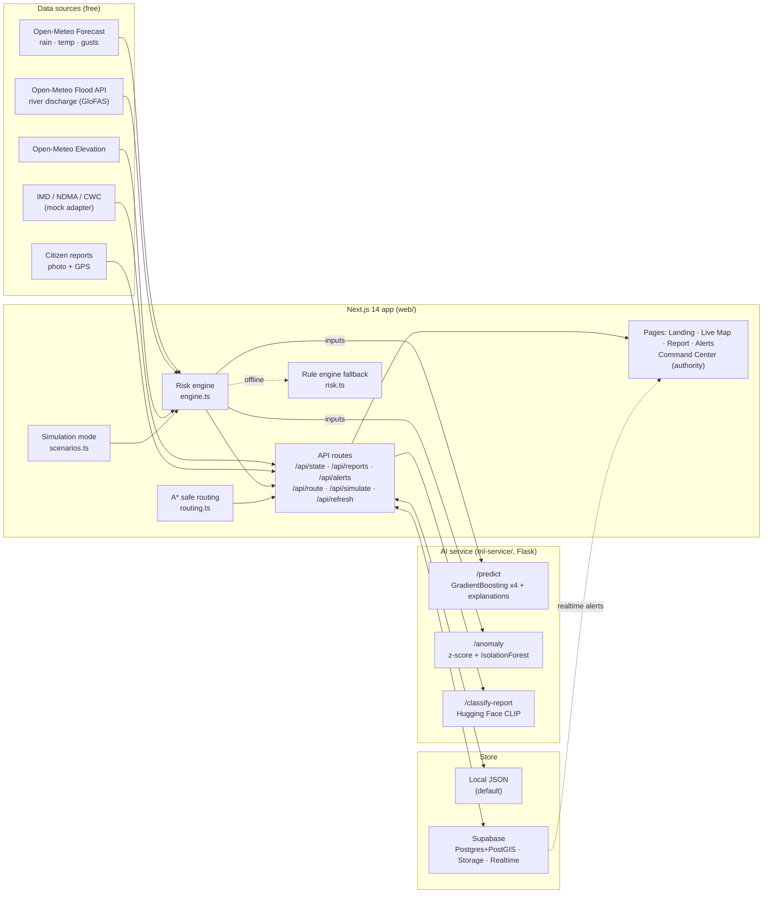
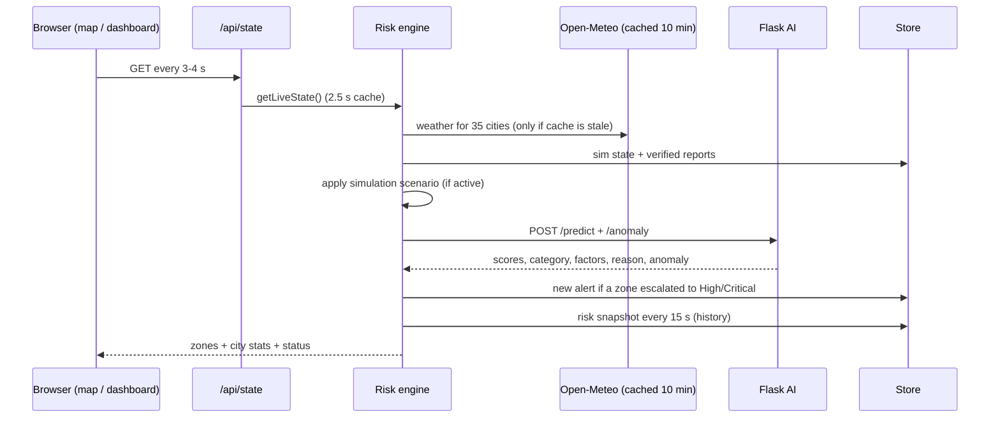
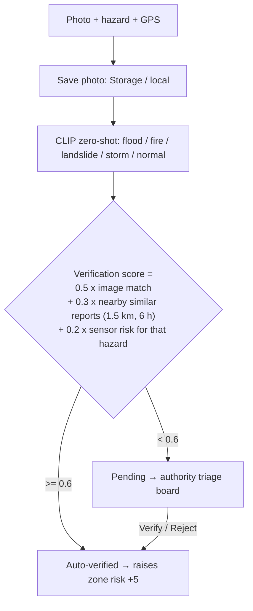
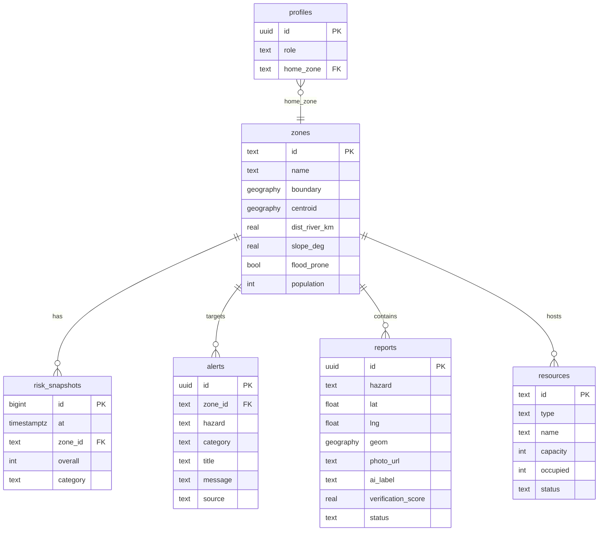

# ResQGrid — Architecture

## System overview

## Request flow: one refresh of live risk

## Citizen report verification

## Data model (Supabase)

## Feature → file map

| Feature (from PPT) | Where |
|---|---|
| Localized risk prediction | `web/src/lib/weather.ts`, `engine.ts`, `ml-service/app.py /predict` |
| AI risk & anomaly detection | `ml-service/train.py`, `app.py /anomaly`, `web/src/lib/risk.ts` (fallback) |
| Real-time community alerts | `engine.ts processAlerts()`, `components/AlertToaster.tsx`, Supabase Realtime |
| Community reporting & feedback | `app/report/page.tsx`, `api/reports/route.ts`, `app.py /classify-report` |
| Authority response dashboard | `app/dashboard/page.tsx`, `components/dashboard/*` |
| Interactive risk map | `components/RiskMap.tsx`, `app/map/page.tsx`, `ZoneDetail.tsx` |
| Smart emergency routing | `lib/routing.ts`, `api/route/route.ts` |
| Multi-language alerts | `src/i18n/{en,hi,mr}.json`, `I18nProvider.tsx` |
| Demo / simulation mode | `lib/scenarios.ts`, `api/simulate/route.ts`, `SimulationControl.tsx` |
| Privacy (~100 m public locations) | `api/reports` GET, `reports_public` view in `schema.sql` |

## Command Center design

The authority dashboard is a dark "mission control" screen built to be read at a glance on a projector:

* **City Threat Index**: a half-dial gauge with a heartbeat line that beats faster as the worst-zone risk rises.
* **Zone Hive**: every city as a glowing hexagon, laid out north→south / west→east like a mini-map.
* **Risk Seismograph**: a heat strip of every zone over the last 2 hours, so you can see *when* each area escalated.
* **Zone Intel**: score ring, hazard radar, AI reasons, anomaly flag and a priority queue of High/Critical zones.
* **Citizen Report Triage**: a kanban board (Incoming / Verified / Rejected) with photo, AI label and verification score.
* **Live Event Feed, Resources** (click to change status), **Broadcast** composer with templates.
